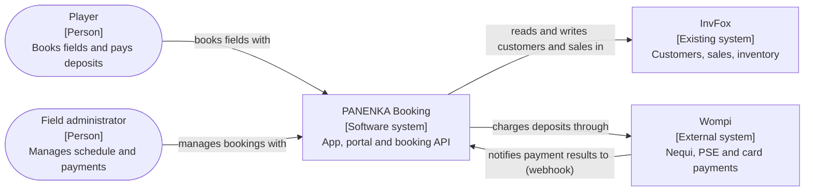
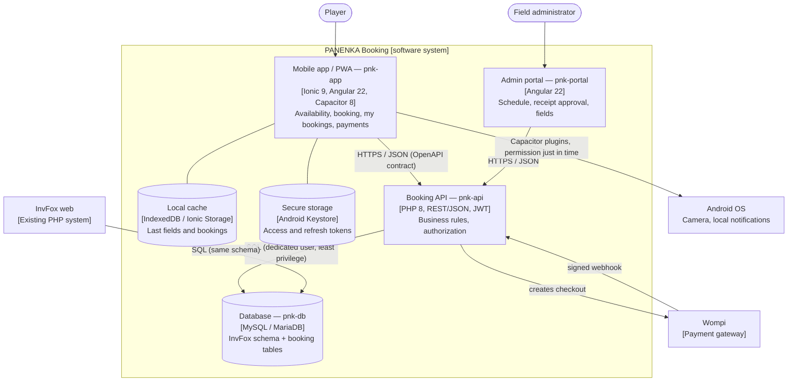

# Architecture Overview

Diagrams follow the [C4 model](https://c4model.com): each box is a person or a software element
and every arrow states **what** flows between them. The PlantUML sources are in [`diagrams/`](./diagrams/);
the Mermaid versions below render directly on GitHub.

## Level 1 — System context

## Level 2 — Containers

## Booking model — field sectors

PANENKA has **one soccer-9 pitch that can be split into three soccer-5 fields**. The system
separates *what is booked* from *the physical space it occupies*:

| Bookable field | Price per hour | Occupies sectors |
|----------------|----------------|------------------|
| Cancha 5A | $70.000 | A |
| Cancha 5B | $70.000 | B |
| Cancha 5C | $70.000 | C |
| Cancha 9 | $210.000 | A + B + C |

A booking holds its sectors for every hour it lasts (`booking_slots`, primary key
`(unit_id, slot_start)`). Because a sector can be held only once per hour, the **database itself**
rejects any overlap:

| Already booked at 18:00 | Can also be booked at 18:00 |
|-------------------------|-----------------------------|
| Cancha 5A | 5B, 5C — **not** Cancha 9 |
| Cancha 9 | none |
| 5A and 5B | 5C — **not** Cancha 9 |

See [ADR-004](./decisions/records/ADR-004-booking-consistency-and-offline-strategy.md) and the
`pnk-db` migrations.
