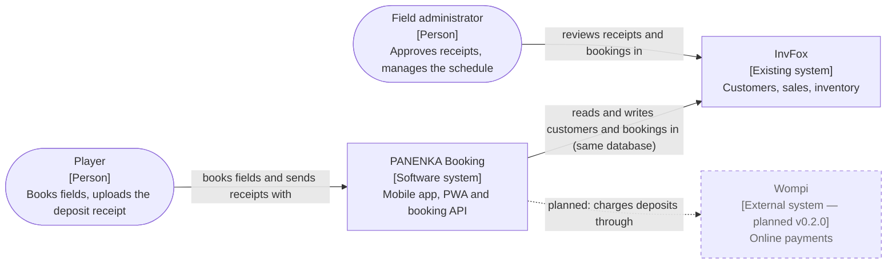
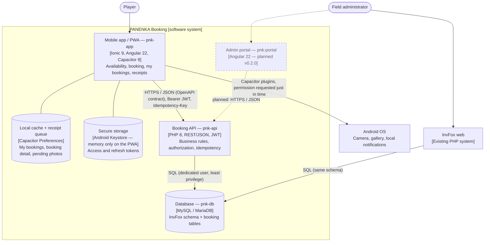
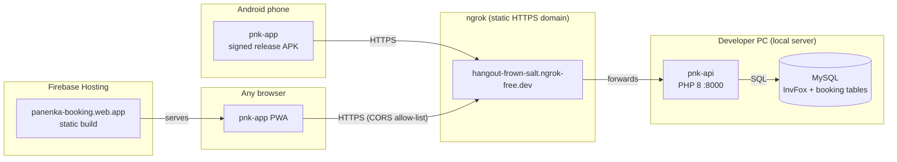

# Architecture Overview

Diagrams follow the [C4 model](https://c4model.com): each box is a person or a software element
and every arrow states **what** flows between them. The Mermaid diagrams below render directly on
GitHub and describe **what is built in v0.1.0**. Elements drawn with a dashed border are
**planned (v0.2.0)** and are not part of the current release. The PlantUML sources in
[`diagrams/`](./diagrams/) show the full target architecture.

## Level 1 — System context

In v0.1.0 the deposit is paid by **Nequi transfer**: the player uploads a photo of the receipt and the
administrator approves it. Online payment (Wompi) is deferred — see
[ADR-006](./decisions/records/ADR-006-web-channels-pwa-and-admin-portal.md) and
[technical debt](../04-quality/technical-debt.md).

## Level 2 — Containers

Storage decisions: [ADR-008](./decisions/records/ADR-008-on-device-storage.md).
Offline behaviour: [offline-sync](../03-api-and-data/offline-sync.md).

## Deployment — v0.1.0

Why this set-up and what replaces it in production:
[ADR-010](./decisions/records/ADR-010-deployment-https-tunnel-firebase.md) and
[deployment](../05-release/deployment.md).

## Booking model — field sectors

PANENKA has **one soccer-9 pitch that can be split into three soccer-5 fields**. The system
separates *what is booked* from *the physical space it occupies*:

| Bookable field | Price per hour | Occupies sectors |
|----------------|----------------|------------------|
| Cancha 5A | $70.000 | A |
| Cancha 5B | $70.000 | B |
| Cancha 5C | $70.000 | C |
| Cancha 9 | $210.000 | A + B + C |

A booking holds its sectors for every hour it lasts (`booking_slots`, primary key
`(unit_id, slot_start)`). Because a sector can be held only once per hour, the **database itself**
rejects any overlap:

| Already booked at 18:00 | Can also be booked at 18:00 |
|-------------------------|-----------------------------|
| Cancha 5A | 5B, 5C — **not** Cancha 9 |
| Cancha 9 | none |
| 5A and 5B | 5C — **not** Cancha 9 |

See [ADR-004](./decisions/records/ADR-004-booking-consistency-and-offline-strategy.md) and the
`pnk-db` migrations.
