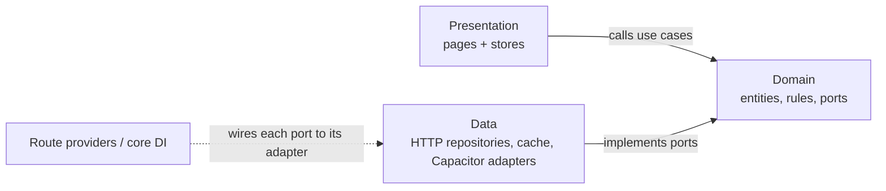

# Layers & State

## Layers

| Layer | Responsibility | Allowed dependencies |
|-------|----------------|----------------------|
| Presentation | Ionic pages and components, stores (view state), user intents | Domain |
| Domain | Entities, value objects, business rules, ports (interfaces), use cases | None |
| Data | Repository implementations, HTTP, cache, DTOs and mappers, Capacitor adapters | Domain |

## Dependency direction



- Domain has **zero** outward dependencies: no `@angular/*`, no `@capacitor/*`, no HTTP, no storage.
- Presentation never imports a data source; it calls a use case.
- Data implements the domain ports (e.g. `BookingsHttpRepository implements BookingsRepository`).
- The DTO (mirror of the API JSON) never leaves `data/`; mappers convert it to domain entities.

### The rule is enforced, not only written

`eslint.config.js` uses `no-restricted-imports` for `src/app/features/**/domain/**`:

```js
{
  files: ['src/app/features/**/domain/**/*.ts'],
  rules: {
    'no-restricted-imports': ['error', {
      patterns: [
        { group: ['@angular/*', '@capacitor/*', '@ionic/*'], message: 'Domain must not depend on frameworks.' },
        { group: ['**/data/**', '**/presentation/**'], message: 'Domain must not depend on outer layers.' },
      ],
    }],
  },
}
```

Lint runs in CI; a pull request that breaks the rule cannot be merged.

## State management

One pattern for the whole app — **MVVM with one store per screen and a private signal**
(see [ADR-001](./decisions/records/ADR-001-state-management-pattern.md)):

- Each screen has its own store (`my-bookings.store.ts`, `booking-confirm.store.ts`, …) provided at
  route level. It keeps an immutable state object in a **private** Angular `signal` and exposes it to
  the page only as a read-only signal; only the store can change it.
- A page renders exactly one state object, which always has one of these statuses:
  `loading`, `loaded`, `empty`, `error`, `offline` (plus `permission-denied` where applicable).
- Pages contain no business logic; they call store methods, the store calls use cases.

```ts
type AvailabilityState =
  | { status: 'loading' }
  | { status: 'loaded'; date: string; slots: FieldSlot[] }
  | { status: 'empty'; date: string; nextDate: string }
  | { status: 'error'; code: string; message: string }
  | { status: 'offline'; cachedAt: string; slots: FieldSlot[] };
```

## Use cases

- One use case = one business action: `CreateBooking`, `CancelBooking`, `GetAvailability`, `SignIn`.
- Use cases receive their ports through the constructor, so they are tested with hand-written doubles
  and no Angular TestBed.
- Business rules live in the domain, e.g. "a booking can be cancelled only 3 hours or more before it
  starts". The API repeats every rule on the server.
