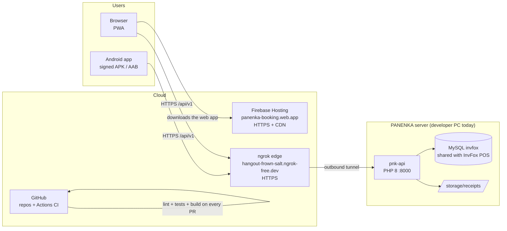

# Deployment — v0.1.0

> How each part of PANENKA Booking reaches its users, what is real and what is simulated, and how
> to bring everything up for a demo.

## Cloud architecture



| Component | Where it runs | Status |
|-----------|---------------|--------|
| Android app | Player's phone (signed release APK; AAB for Google Play) | **Real** — installed on a HONOR RMO-NX3 |
| Web app (PWA channel, ADR-006) | Firebase Hosting, project `panenka-booking` | **Real** — `https://panenka-booking.web.app` |
| pnk-api | PHP built-in server on the PANENKA PC, published through an **ngrok static domain** | **Real**, available while the PC and the tunnel are on |
| Database | MySQL `invfox`, the same database as the InvFox POS (ADR-005) | **Real** |
| CI | GitHub Actions (`pnk-app/.github/workflows/ci.yml`) | **Real** |
| Google Play publication | Play Console | **Simulated** — see [`signing-and-stores.md`](./signing-and-stores.md) |
| iOS (IPA / App Store) | Xcode + App Store Connect | **Simulated** — requires macOS and an Apple Developer account |

## Why a tunnel and not a hosting provider for the API

- The API shares the MySQL database of the InvFox POS that already runs at PANENKA, so the API has
  to live next to that database.
- An **ngrok static domain** gives a fixed public `https://` URL with a valid certificate, without
  opening router ports: the PC opens an **outbound** connection to ngrok and ngrok forwards the
  requests through it.
- The free plan answers browser requests with a warning page; the app skips it by sending
  `ngrok-skip-browser-warning: true` (`headersInterceptor`), which the API allows in CORS.
- **Target for production:** move pnk-api to a VPS or PHP hosting with its own domain
  (`api.panenka.co`), keep HTTPS and add certificate pinning. Only `environment.prod.ts` and the
  CORS list change; the app code does not.

## Environments

| Build | Command | API base URL | Cleartext |
|-------|---------|--------------|-----------|
| Development (browser) | `npm start` | `http://localhost:8000/api/v1` | n/a |
| Mock (no backend) | `npm start` with the Prism mock | `http://localhost:4010` | n/a |
| LAN demo on the phone | `ng build --configuration device` + `PNK_LAN=1 npx cap sync android` | `http://192.168.1.24:8000/api/v1` | allowed |
| **Production** (web, release APK/AAB, CI) | `ng build --configuration production` + `npx cap sync android` | `https://hangout-frown-salt.ngrok-free.dev/api/v1` | **blocked** |

## Runbook — bring everything up

1. **Database:** start MySQL in XAMPP.
2. **API:** `cd pnk-api && /d/xampp/php/php.exe -S 0.0.0.0:8000 -t public`
3. **Tunnel:** `ngrok http 8000 --url https://hangout-frown-salt.ngrok-free.dev`
   (the panel must show `Forwarding … -> http://localhost:8000`).
4. **Check:** open `https://hangout-frown-salt.ngrok-free.dev/api/v1/health` → `{"status":"ok"}`.
   The ngrok traffic inspector is at `http://127.0.0.1:4040`.

## Runbook — publish a new version

```bash
# pnk-app, on develop with CI green
npm run lint && npm run test:unit
npx ng build --configuration production
firebase deploy --only hosting            # web: new version, previous one kept for rollback
npx cap sync android
cd android && ./gradlew assembleRelease bundleRelease && cd ..   # signed with the PANENKA key
adb install -r android/app/build/outputs/apk/release/app-release.apk   # update keeps the data
```

- **Rollback (web):** Firebase console → Hosting → release history → *Rollback*.
- **Rollback (Android):** reinstall the previous signed APK; on Google Play, halt the staged rollout.

## Configuration that is NOT in Git

| File | Content | Owner |
|------|---------|-------|
| `pnk-api/config/config.php` | DB password, JWT secret, CORS origins | Release owner |
| `pnk-app/android/keystore.properties` | Keystore path and passwords | Release owner |
| `D:\PROYECTOS\panenka\keys\panenka-release.jks` | Release signing key (backed up offline) | Release owner |
| ngrok authtoken | `ngrok.yml` in the user profile | Release owner |
