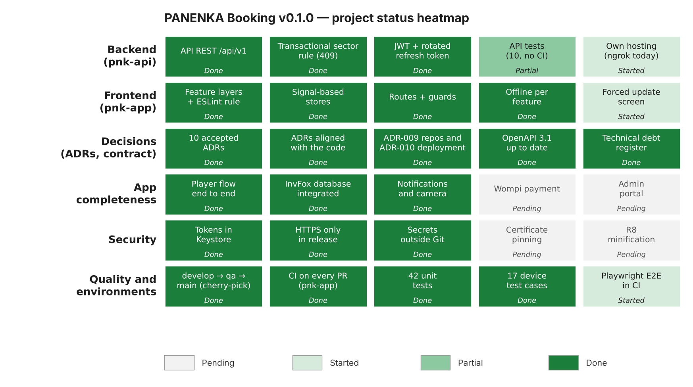

# pnk-docs — PANENKA Booking

Single source of truth for the governance and technical documentation of **PANENKA Booking**,
a booking system for synthetic soccer fields made of a mobile app, a web portal and a REST API
integrated with the InvFox point-of-sale system.

The project follows **SDD (Software Design Documentation)**: design is written and reviewed here
**before** it is implemented in the code repositories, and it is updated with every change.

## Project repositories

| Repository | Purpose | Branches | Status (v0.1.0) |
|---|---|---|---|
| [pnk-docs](https://github.com/AndresGalindo2227/pnk-docs) | Governance and documentation (this repository) | `main` | `v0.1.0` |
| [pnk-api](https://github.com/AndresGalindo2227/pnk-api) | Business core: REST API (PHP 8) integrated with InvFox | `develop`, `qa`, `main` | `v0.1.0` |
| [pnk-app](https://github.com/AndresGalindo2227/pnk-app) | Mobile app and PWA (Ionic, Angular, Capacitor) | `develop`, `qa`, `main` | `v0.1.0` (signed APK/AAB) |
| [pnk-db](https://github.com/AndresGalindo2227/pnk-db) | Versioned MySQL migrations and seed data | `develop`, `qa`, `main` | `v0.2.0` |
| `pnk-portal` | Web portal for administrators (ADR-006) | — | Planned for v0.2.0 |
| `pnk-infra` | Docker Compose orchestration | — | Planned |

Why one repository per deployable unit: [ADR-009](./01-architecture/decisions/records/ADR-009-repository-strategy-polyrepo.md).

Product backlog: [pnk-backlog](https://github.com/users/AndresGalindo2227/projects/5)

Every change to `main` (and to `develop` / `qa` in the code repositories) is made through a Pull Request.

## Sections

Filled in this order; `00-governance` applies to every section.

| # | Section | Content |
|---|---|---|
| [00](./00-governance/) | Governance | Agile process, git conventions, DoR / DoD, security rules |
| [01](./01-architecture/) | Architecture | Project structure, layers, state, navigation, ADRs, C4 diagrams |
| [02](./02-code-and-ui/) | Code & UI | Coding standards, design system, accessibility, i18n |
| [03](./03-api-and-data/) | API & Data | API contract (OpenAPI), authentication, persistence, offline |
| [04](./04-quality/) | Quality | Testing strategy, performance budgets, mobile security |
| [05](./05-release/) | Release | CI/CD, signing, store distribution, observability |

Start with [00-sdd-guide.md](./00-sdd-guide.md) for the methodology.

## Project status (v0.1.0)

Release record: [05-release/releases/v0.1.0.md](./05-release/releases/v0.1.0.md) ·
Known technical debt: [04-quality/technical-debt.md](./04-quality/technical-debt.md)

## Credits

Structure and templates based on the
[Mobile Governance Framework](https://github.com/jesusarielgb-works/mobile-governance-framework)
by Jesús Ariel González Bonilla (MIT). See [NOTICE.md](./NOTICE.md).

## License

MIT — Andrés Felipe Galindo Dávila. See [LICENSE](./LICENSE).
